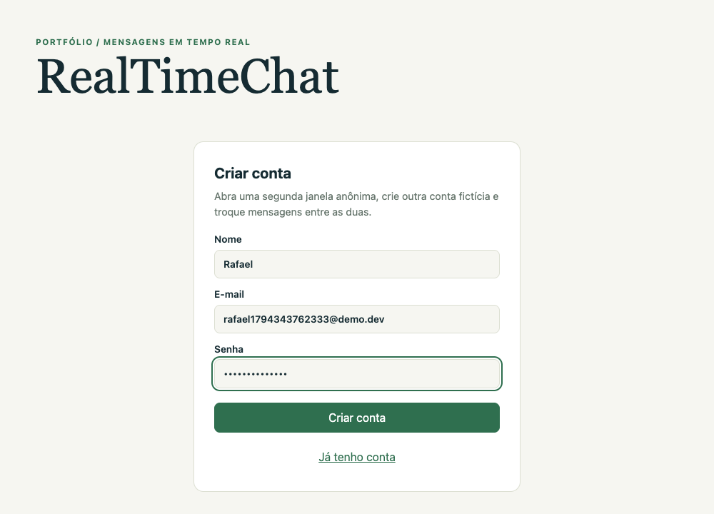
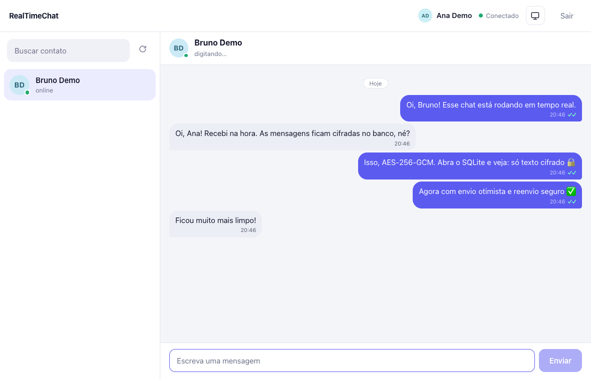
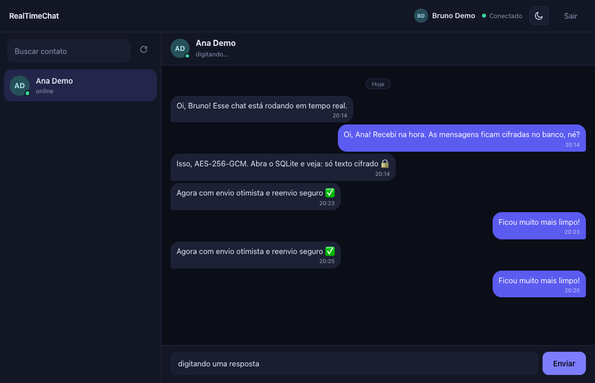

# RealTimeChat

<p>
  
  
  
  
  
  
</p>

Chat de mensagens privadas em tempo real: cadastro, lista de contatos com presença online, indicador de "digitando…" e histórico. As mensagens ficam **cifradas no banco**.

| Entrada | Conversa (tema claro) |
|---|---|
|  |  |

| Tema escuro | Celular |
|---|---|
|  |  |

## O que este projeto demonstra

| Área | O que foi aplicado |
|---|---|
| **Tempo real** | Socket.IO com salas por usuário, presença multi-aba, "digitando…" e contador de não lidas persistente e **confirmação de leitura** (✓ enviada, ✓✓ lida) |
| **Confiabilidade** | envio otimista (a bolha aparece na hora), falha com "Tentar de novo" e **idempotência por `clientId`**: reenviar após uma queda não duplica a mensagem |
| **Histórico** | paginação por cursor (`before=<id>`) com rolagem infinita para cima que preserva a posição da tela; sem repetir nem pular mensagens quando chegam novas |
| **Interface** | tema claro, escuro ou automático (sem piscar ao carregar), layout responsivo (lista ↔ conversa no celular), separadores de dia, avatares, acessível por teclado |
| **Segurança** | JWT validado no socket (o remetente vem do token, não do payload), CORS/origem restritos, Helmet, rate limit em login/cadastro e por socket, limites de tamanho, bcrypt, mensagens com AES-256-GCM, respostas anti-enumeração |
| **Testes** | 31 testes com servidor real e SQLite temporário: cifra, auth, isolamento entre usuários, presença, limites |
| **Arquitetura** | back-end modular (`config`, `auth`, `vault`, `routes`, `sockets`), front com estado em stores e componentes pequenos |
| **Operação** | Docker Compose (API + web), logs JSON (Pino) sem tokens, `/health`, encerramento gracioso, CI no GitHub Actions |

Decisões e limites conhecidos: [docs/arquitetura.md](docs/arquitetura.md).

## Rodar com Docker

```sh
cp .env.example .env
# edite .env e defina JWT_SECRET (instrução no próprio arquivo)
docker compose up -d --build
```

- App: http://127.0.0.1:3090
- API: http://127.0.0.1:3091 (`/health`)

### Contas de demonstração (seed)

Para não precisar cadastrar nada, popule duas contas fictícias com uma conversa de exemplo:

```sh
docker compose exec api npm run seed
```

| Usuário | E-mail | Senha |
|---|---|---|
| Ana Demo | `ana@demo.dev` | `demo12345` |
| Bruno Demo | `bruno@demo.dev` | `demo12345` |

Na tela inicial há botões **Entrar como Ana/Bruno** (controlados por `PUBLIC_DEMO_LOGIN`; desligue em ambiente público). Entre como Ana numa janela normal e como Bruno numa janela anônima, e troque mensagens entre os dois. O seed é idempotente (pode rodar mais de uma vez). Sem Docker: `cd back-end && npm run seed`.

Se preferir, crie suas próprias contas fictícias. Se uma conta for criada depois de a outra janela já estar aberta, use **Atualizar**. Para zerar os dados: `docker compose down -v`.

As portas (3090/3091) foram escolhidas para não colidir com outros projetos locais; mude com `WEB_PORT_HOST` e `API_PORT_HOST` no `.env`.

## Rodar sem Docker

Node.js 22 ou 24.

```sh
# back-end
cd back-end
cp .env.example .env        # defina JWT_SECRET
npm ci
npx prisma generate
npx prisma migrate deploy
node server.js              # http://127.0.0.1:3000

# front-end (outro terminal)
cd front-end
cp .env.example .env
npm ci
npm run dev -- --host 127.0.0.1 --port 5173 --strictPort
```

## Testes

```sh
cd back-end && npm test
cd front-end && npm run check
```

## API

| Rota | Descrição |
|---|---|
| `POST /register` | `{name, email, password}` (senha de 8 a 72 bytes) |
| `POST /login` | devolve `{token, user}` (JWT de 50 min) |
| `GET /users` | outros usuários, se estão online e quantas mensagens não lidas há de cada um |
| `GET /messages/:peer?before=<id>&limit=<n>` | página de mensagens decifradas (padrão 30, máx. 100) mais `hasMore`; `before` é o cursor (id da mais antiga que você já tem) |
| `GET /health` | verificação de saúde |

Eventos Socket.IO (conexão com `auth: {token}`): `read` (`{peerId}`: marca a conversa como lida), `message` (envia `{receiverId, content, clientId}` com ack; o servidor devolve o evento com o mesmo `clientId`), `typing`, `presence`.

## Escopo

É uma demo local. Uma implantação pública precisaria de rate limit compartilhado entre instâncias, recuperação de senha, observabilidade e revisão de segurança. Não é criptografia ponta a ponta: o servidor decifra para entregar o histórico.
