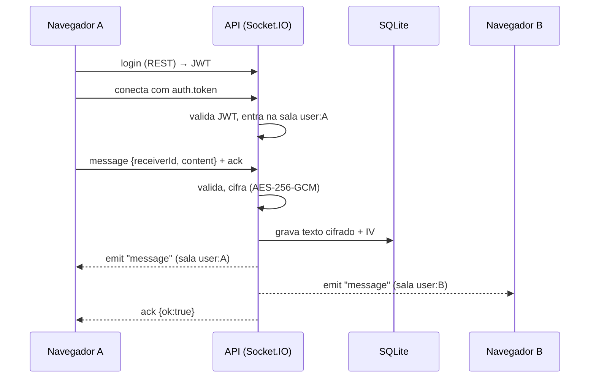

# Arquitetura e decisões

## Fluxo de uma mensagem

## Estrutura

| Caminho | Responsabilidade |
|---|---|
| `back-end/server.js` | ponto de entrada: config, Prisma, listen e encerramento gracioso |
| `back-end/src/app.js` | monta Express + Helmet + CORS + Socket.IO |
| `back-end/src/routes.js` | `/register`, `/login`, `/users`, `/messages/:peer`, `/health` |
| `back-end/src/sockets.js` | autenticação do socket, salas, presença, digitação, envio |
| `back-end/src/auth.js` | emissão e validação do JWT |
| `back-end/src/vault.js` | cifra e decifra as mensagens |
| `back-end/test/` | testes com servidor real e SQLite temporário |
| `front-end/src/lib/chat.ts` | estado e conexão (stores do Svelte) |
| `front-end/src/lib/*.svelte` | `AuthForm`, `ContactList`, `Conversation` |

## Decisões

- **Remetente vem do token, nunca do payload.** Um cliente não consegue enviar "como" outro usuário (há teste para isso).
- **Uma sala por usuário (`user:<id>`).** Várias abas do mesmo usuário recebem tudo, e a presença só vira offline quando a última aba sai.
- **Cifra em repouso (AES-256-GCM).** O banco guarda só texto cifrado, com IV aleatório e tag de autenticação; adulteração falha na leitura. A chave deriva do `JWT_SECRET`. Não é criptografia ponta a ponta: o servidor decifra para entregar.
- **Token só em memória no navegador.** Evita `localStorage` (XSS); o custo é pedir login ao recarregar a página.
- **A conexão morre com o token.** O servidor desconecta o socket quando o JWT expira.
- **Limites em todas as bordas.** Corpo HTTP 16 kB, buffer do socket 16 kB, mensagem de 2000 caracteres, 30 mensagens/min por socket, 20 tentativas/min de login e cadastro por IP.
- **Erros genéricos.** Login não revela se o e-mail existe; falhas internas não vazam detalhes.
- **Senha de até 72 bytes.** É o limite do bcrypt; acima disso a API recusa em vez de truncar em silêncio.
- **SQLite + Prisma.** Zero configuração para uma demo. A troca por Postgres é só o `provider` e a `DATABASE_URL`.

## Envio otimista e idempotência

1. O front gera um `clientId`, mostra a bolha como "enviando…" e emite `message` com ack.
2. O servidor grava, e emite `message` (com o mesmo `clientId`) para as duas salas; o front troca a bolha pendente pela confirmada.
3. Se o ack não chega (queda de rede), a bolha vira "não enviada" com **Tentar de novo**. O reenvio usa o mesmo `clientId`; o servidor lembra dos últimos 100 ids de cada usuário e responde `{ok, duplicate}` sem gravar de novo.

Limite: a memória de ids é por processo; com várias instâncias seria uma chave única no banco ou Redis.

## Confirmação de leitura

- `Message.readAt` é preenchido quando o destinatário abre a conversa (evento `read {peerId}`). O servidor marca tudo que o `peerId` enviou até o maior id pendente, e emite `read {readerId, peerId, upTo}` para o remetente (que mostra ✓✓) e para as outras abas do leitor (que zeram o contador).
- O leitor sempre vem do token, então ninguém marca como lida uma conversa que não é sua.
- O front só envia `read` com a aba visível; ao voltar para a aba, marca o que chegou enquanto estava oculta.
- As não lidas vêm do banco (`GET /users`, uma consulta `groupBy`), então sobrevivem a reload e a novos logins.

## Próximos passos possíveis

- Estado "entregue" (hoje há enviada e lida) e cursor "lido até" por conversa no lugar de `readAt` por mensagem.
- Paginação do histórico com rolagem infinita.
- Redis adapter do Socket.IO e rate limit compartilhado, para rodar com várias instâncias.
- Reações e anexos.

## Limites conhecidos (fora do escopo da demo)

- Rate limit em memória: com várias instâncias seria preciso um store compartilhado (Redis) e o adapter do Socket.IO.
- Sem refresh token, sem recuperação de senha, sem confirmação de e-mail.
- Sem exclusão de mensagens nem anexos.
